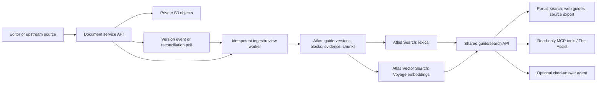

# Proposed integrations: document service, S3, MongoDB Atlas, and Voyage AI

> **Design proposal, not implemented.** The current Silly Goose Mutual repository uses PostgreSQL/pgvector, local artifact storage, local embeddings, and its existing extraction workflow. This document describes a possible integration path. No document-service vendor, Atlas cluster, Voyage account, S3 bucket, AgentCore runtime, or The Assist connection is configured by this proposal. All Silly Goose guide and approval content remains synthetic.

## What this adds to the product

One versioned, cited knowledge service should power (1) corpus search on the portal home, (2) web-native guide pages, (3) an internal ask-the-guides experience, and (4) read-only tools for The Assist or other authorized agents. Users can still export the exact original legacy PDF. New edits travel through DOCX/ODT drafts and a reviewed publication step. The guide website and every search citation resolve to the same published version.

The proposed document-management service is the **front door to a private S3-backed document store**. It owns file intake, storage references, document versions, and, if available, OCR/extraction. Silly Goose owns product/state identity, reviewed guide structure, search, answer evidence, and web presentation. MongoDB Atlas is a derived read model and search index, not a second system where people edit source files. Voyage AI generates versioned embeddings from reviewed chunks. The exact vendor and API contract must be discovered before implementation.

## Ownership and integration boundaries

| Concern | Proposed owner | Contract |
| --- | --- | --- |
| Original PDF, edited DOCX/ODT, rendered PDFs | Document service backed by private S3 | Immutable version ID, SHA-256, MIME type, size, authorized byte retrieval. Keep the original PDF byte-for-byte. |
| OCR and extraction | Document service if it meets the evidence contract; otherwise current extractor as fallback | Page order, text, tables, footnotes, bounding boxes, confidence, extractor version, and source hash. Extraction is unreviewed evidence. |
| Guide lineage and publication | Silly Goose workflow, synchronized to upstream versions | Product, state, edition, parent revision, approval status, effective dates, current published version. A vendor's storage version is not automatically an approved edition. |
| Reviewed web guide and citations | Silly Goose | Structured GuideBlocks and evidence spans bound to an exact source artifact hash and page. |
| Search read model | MongoDB Atlas | One version-aware corpus for lexical and vector retrieval, coverage tracking, and stable evidence IDs. |
| Embeddings | Voyage AI worker | Explicit model, dimensions, input type, text hash, and index version. Recompute only changed chunks. |
| Answer generation | Optional agent runtime | Read-only search/section tools; claims cite exact evidence or abstain. No publish/approve authority. |

The document service should front S3 for both uploads and downloads. The app should call the service's authorized API or receive a short-lived URL from it **after** permission checks. It should not hard-code bucket keys, use public S3 URLs, or give an MCP client raw S3 access. If a service returns presigned URLs, treat them as temporary bearer capabilities and avoid storing them in Atlas, logs, or answers. [AWS presigned URL guidance](https://docs.aws.amazon.com/AmazonS3/latest/userguide/using-presigned-url.html).

S3 Versioning can preserve object versions, but it does not by itself express insurance guide approval or publication. If retention requirements call for stronger immutability, evaluate S3 Object Lock with the document-service owner; do not assume it is enabled. [S3 Versioning](https://docs.aws.amazon.com/AmazonS3/latest/userguide/Versioning.html), [S3 Object Lock](https://docs.aws.amazon.com/AmazonS3/latest/userguide/object-lock.html).

### Vendor discovery checklist

Before choosing an adapter, obtain sample API responses and answer these questions: Can the service enumerate changes or send versioned webhooks? Can it retrieve the original bytes and an exact historical version? Does it expose SHA-256 or permit a checksum verification? Are OCR tables, footnotes, page numbers, boxes, and confidence available? Who owns S3 keys and retention? How are service identities, per-document permissions, signed downloads, deletes, and audit events handled? Can a new DOCX/ODT draft be uploaded without overwriting a published PDF? How are corrected extractions distinguished from new document versions? What are rate limits, backfill/export paths, and outage behavior? Record unknowns instead of inventing vendor capabilities.

## Minimum document-service adapter

The application-facing interface can be vendor-neutral even if the first integration is specific:

| Operation | Required behavior |
| --- | --- |
| `listChanges(cursor)` or `reconcile(since)` | Returns stable document/version IDs, event time, and continuation cursor; supports replay. |
| `getVersion(documentId, versionId)` | Returns metadata, parent version, product/state hints, status, and artifact manifest. |
| `getArtifact(artifactId, versionId)` | Returns authorized bytes or a short-lived download capability for the exact version. Verify size and SHA-256 on intake. |
| `getExtraction(artifactId, extractionVersion)` | Returns page-anchored text, reading order, tables/footnotes, coordinates, confidence, source hash, and extractor version when supported. |
| `createDraft(parentVersionId, artifact, metadata)` | Uploads an editable successor as a draft and returns a new immutable version; never overwrites its parent. |

Minimum event fields: `provider`, `upstream_document_id`, `upstream_version_id`, `event_id`, `event_type`, `observed_at`, `source_artifact_id`, `source_sha256`, and `extraction_version` if extraction changed. Use `provider + upstream_document_id + upstream_version_id + source_sha256 + extraction_version` as an idempotency key. A duplicate or out-of-order event must not create a new edition or replace the published pointer. Run scheduled reconciliation even if webhooks exist.

**Review boundary:** OCR text can be indexed as provisional evidence, but uncertain values, tables, exclusions, and footnotes need review before they become definitive GuideBlocks or cited answer claims. A vendor may report a successful extraction while a state-specific condition is missing. Record extraction flags and guide coverage visibly.

## Atlas and Voyage read model

Proposed collections (names illustrative):

| Collection | Key records and indexes |
| --- | --- |
| `guide_versions` | `guide_id`, product, state, edition, parent, publication state, current flag, dates, upstream IDs, source hash, artifact IDs. Unique version identity; at most one current published version per product/state lineage. |
| `guide_blocks` | Reviewed headings, paragraphs, tables, footnotes, stable section IDs, source evidence spans. Drives the same web-native view for old PDFs and new DOCX/ODT editions. |
| `search_chunks` | Chunk text, guide/version/section/page, evidence ID, source hash, review status, product/state filters, text hash, embedding model/version/dimensions/vector. Lexical and vector indexes target the same exact version. |
| `ingest_jobs` and `audit_events` | Cursor, idempotency key, retries, failure reason, reviewer/publication events, indexing coverage. |

Use [MongoDB Search](https://www.mongodb.com/docs/v8.0/text-search/) for lexical retrieval of exact terms, codes, phrases, and numbers. Use [MongoDB Vector Search filter fields](https://www.mongodb.com/docs/vector-search/indexes/vector-search-type/) to constrain semantic results by authorized guide/version/state **before ranking**. Only indexed, current published versions are in the default corpus. Historical results require explicit selection and a historical label. For hybrid retrieval, evaluate lexical and vector candidate sets and fusion on the existing challenge queries; Atlas supports [hybrid full-text and vector search](https://www.mongodb.com/docs/vector-search/hybrid-search/hybrid-search-overview/). Keep lexical results available when embeddings or the answer agent fail.

Choose a Voyage model and output dimension through an evaluation, not a hard-coded promise in this proposal. Embed reviewed chunks with `input_type: document` and questions with `input_type: query`, following [Voyage's retrieval guidance](https://docs.voyageai.com/docs/embeddings). Preserve the exact input text hash, model ID, dimensions, and generation time. A model change creates a parallel index; do not mix dimensions or silently rewrite the old vectors. Re-embed only changed chunks, and compare recall, citation validity, latency, and cost before cutover. Atlas automated Voyage embedding may be evaluated later; an explicit worker gives the first migration a clearer replay and audit path.

The current repository's 384-dimensional local embeddings and PostgreSQL `tsvector`/pgvector indexes are the **implemented baseline**. Do not claim Atlas/Voyage parity from the existing Postgres benchmark. Re-run the fixed ground truth and realistic hard-question sets on the new path; preserve document/page citation validation, state scope, current-version defaults, absent-answer behavior, and prompt-injection tests. [Current retrieval design](retrieval.md), [current corpus contract](corpus.md).

## Portal, export, and agent behavior

- Portal home asks across the entire authorized published corpus; an in-guide Ask sets an exact guide/version scope. Show retrieved passages quickly, then an optional cited answer. Show coverage and indexing gaps.
- A result opens the responsive, web-native guide at its section. The PDF is a source/export action. The legacy original download goes through the document service and must match its recorded SHA-256.
- New editing starts with a DOCX template or ODT export derived from the published guide. Upload through the document service creates a draft successor. Diffs, review, simulated DOI history, and publication are tied to that exact artifact/version. The synthetic demo must never imply real DOI approval.
- Read-only MCP tools for The Assist and other authorized agents reuse the same guide/search API. The portal password gate is separate from service-to-service authentication. Each tool enforces caller scope server-side and returns stable evidence IDs plus authorized guide links; no raw bucket path or approval/publish tool. See the [current guide workspace](workspace.md) for the existing answer flow.

## Migration and decision gates

1. **Inventory:** Record current corpus/manifest counts, artifact hashes, Postgres index coverage, query quality, answer quality, and access-gate behavior. Preserve a repeatable baseline. Do not use a reachable homepage as search proof.
2. **Document-service pilot:** Integrate one product, several states, both editions, and a draft successor. Reconcile original bytes/hashes, extraction, parent versions, permissions, and source-page links. Use a fixture adapter until vendor API and access exist.
3. **Atlas lexical mirror:** Import version metadata, reviewed blocks, and chunks without changing live traffic. Prove exact phrase, numeric table, state exception, old-edition, and missing-term retrieval. Reconcile all target guide IDs and index coverage.
4. **Voyage shadow index:** Embed only reviewed chunks, build filter fields, and evaluate vector/hybrid retrieval against the current baseline. Keep production search on the existing path until scope, citation, latency, and cost gates pass.
5. **Shared service and cutover:** Put portal search, web guide, original export, and MCP behind one version-aware API. Test unauthorized portal and MCP requests, document-service outage, embedding outage, rollback, and backup/restore. Change the live read path only after parity and source integrity are measured.
6. **Routine deploys:** Deploy web/API changes independently of corpus import, OCR, and embedding jobs. Use durable queues and resumable cursors; no full rebuild during a normal deploy. Report local, staging, and live states separately.

### Acceptance evidence required before claiming an integration

- Vendor API contract and a tested fixture or real connector, with explicit labels for each.
- Original PDF bytes and SHA-256 match the document-service version; DOCX/ODT uploads create new draft versions rather than overwrites.
- Atlas guide/version counts, lexical index coverage, citation/page validity, and no unauthorized state/version results are measured.
- Voyage model/dimension/index versions are recorded; lexical search survives Voyage and LLM outages.
- Portal, an MCP client, and The Assist (only if its actual environment is available) resolve the same current evidence IDs for the same authorized question.
- Source parity review covers values, exclusions, tables, footnotes, and state addenda in both legacy and modern web views.
- Private artifact access, fresh unauthenticated denial, rollback, and incremental deployment timing are demonstrated on the deployed environment.

## Open decisions

The document-service vendor and its API/auth model; which party owns S3 buckets and retention; whether it provides usable OCR/extraction; where editorial review lives; target Atlas tier and network path; Voyage model/dimension after evaluation; whether AgentCore hosts the answer agent or only fronts tools; and whether The Assist can be tested end to end. These are implementation decisions, not prerequisites for publishing this architecture proposal.
